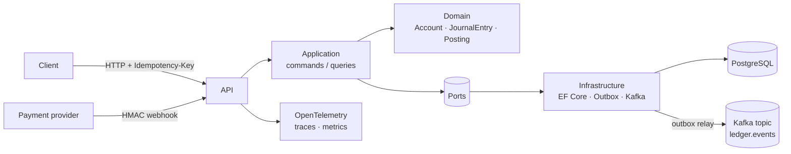
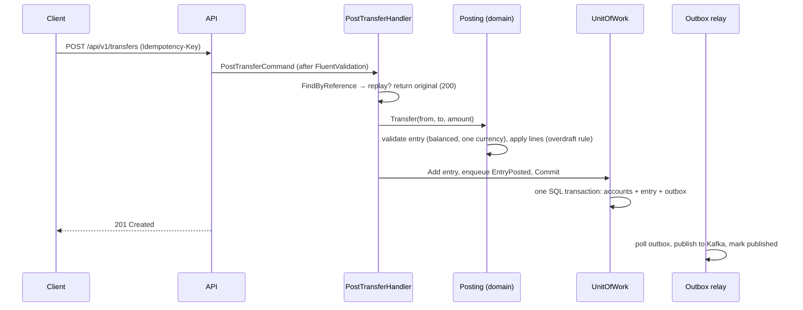
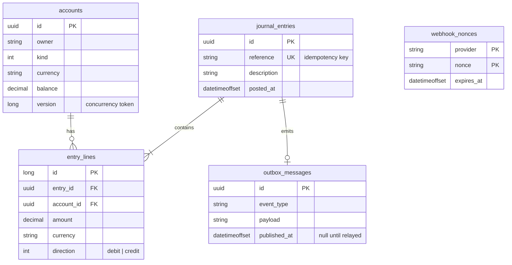

# Architecture

The platform records money movements for a payments product: customer balances, settlements with
payment providers and platform fees. It is a reference implementation, small enough to read in an
afternoon, built the way a production ledger has to be built.

## Shape

Dependencies point inwards: API → Application → Domain. Infrastructure implements the ports the
application declares. Nothing in the domain knows about HTTP, EF Core or Kafka.

## Request path for a transfer

## Layers

| Layer | Responsibility | Must not |
|---|---|---|
| Domain | Money, Currency, Account, JournalEntry, Posting, integration events | Reference frameworks; expose setters for balances |
| Application | Commands/queries, validation, idempotency, webhook verification, ports | Know which database or broker is used |
| Infrastructure | EF Core mapping, repositories, unit of work, outbox, Kafka, replay guard | Contain business rules |
| API | Endpoints, auth, error mapping, logging, tracing, health | Call repositories directly |

## Data model

## Invariants and where they live

| Invariant | Enforced by | Backed by |
|---|---|---|
| Entry debits equal credits | `JournalEntry.Create` | unit tests |
| Customer accounts never negative | `Account.Apply` | unit + integration tests |
| Same reference never posts twice | `PostTransferHandler`, `RecordProviderSettlementHandler` | unique index on `journal_entries.reference` |
| Balance + entry + event saved together | `UnitOfWork.Commit` | single `SaveChanges` transaction |
| Concurrent updates do not overwrite | `accounts.version` concurrency token | 409 response, client retries with same key |
| Webhook accepted only if every check passes | `WebhookVerifier` | unit + integration tests |
| Nonce used once | `EfReplayGuard` | primary key on (provider, nonce) |

## Observability

- Serilog writes one JSON line per event; the trace id is included automatically.
- OpenTelemetry exports traces and metrics over OTLP. Health endpoints are excluded from traces.
- Every rejected request is logged with its reason at Information level; the client receives only the status code.

## Decisions

See `docs/adr/`.
